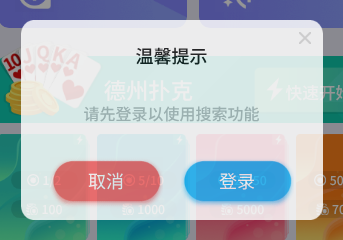
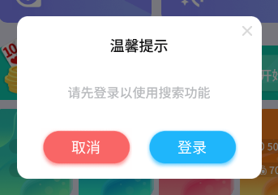

# 动画视觉回归验证

首个用例：**游客点击大厅搜索，登录提示弹窗淡入**。访问已部署的 H5 staging，
通过真实搜索按钮触发，不登录、不建房、不提交业务操作。

沿用 Playwright 1.61.1 和现有 Docker 渲染环境，固定简中、375×812、DPR 1。
本目录的配置、基准和报告独立于静态视觉套件。相关 PR 和 master 更新会触发
`H5 动画视觉回归`，在 Linux 容器中连续对比三次，不重试、不自动更新基准；也支持手动触发。
CI 保存 HTML 报告、差异图和时间采样附件 14 天。

## 运行

在仓库根目录执行（需要 Docker，首次运行可先构建现有视觉镜像）：

```bash
docker compose -f visual/docker-compose.yml build visual
npm --prefix visual run test:animations

# 用新页面连续验证五次，不靠失败重试掩盖不稳定
npm --prefix visual run test:animations -- --repeat-each=5

# 有意修改视觉效果后生成候选基准，检查差异再提交
npm --prefix visual run test:animations -- --update-snapshots
```

运行器在容器中安装锁定的依赖。普通 compare 对缺失基准直接报错，不自动创建或接受截图。
正式基准在 Docker/Linux 生成；不要用 macOS 本地截图覆盖。

## 测试方式

1. 正常初始化应用，复用现有的游客网络夹具和语言配置，保留真实动画。
2. 打开并关闭一次弹窗，等待图片和字体加载，避免采样期间出现缺图。
3. 暂停在固定的虚拟时刻，然后真实点击搜索。确认弹窗已挂载且透明度为 0。
4. 用 `page.clock.runFor` 推进到 **0、80、160、320ms**，每个时刻暂停并截图。
   时间点为固定毫秒数，不根据当前动画时长自动调整。
5. 验证中间帧逐渐显现、320ms 时完全显示、继续推进后不回跳；取消后重新点击搜索，
   确认遮罩释放且入口仍可用。

当前部署的弹窗淡入由 JS 驱动，因此使用虚拟时钟控制；截图保留 `animations: 'allow'`，
不注入 `__VISUAL_REGRESSION__`、禁动画 CSS、透明度或位移修正规则。
测试只读取弹窗及祖先的实际透明度。若实现迁移为 CSS 或其他渲染方式，需要重新验证控制方法。

截图固定裁切 `(16, 286, 343, 240)`，包含完整弹窗和周围遮罩；裁切区域不跟随元素移动，
避免位置偏移被自动抵消。背景使用既有固定牌局夹具。允许最多 0.1% 的像素差异，
颜色差异阈值为 0.1；不通过扩大容差处理时间漂移。

| 0ms | 80ms | 160ms | 320ms |
| --- | --- | --- | --- |
|  |  |  |  |

## 查看结果

HTML 报告：`visual/playwright-report/animations/index.html`。
失败截图和差异图：`visual/test-results/animations/`。
报告附带 `animation-timeline`，记录采样时间、实际透明度和裁切区域，截图比较失败时也保留已采样数据。

关键帧比较用于发现外观、时间进度及终态问题，不用于衡量真实设备掉帧或流畅度。
